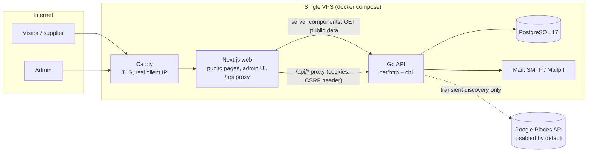

# Architecture

## Components



- **One Go binary** (`apps/api`) serves the API and runs migrations, seeding, admin creation and maintenance jobs.
- **One Next.js app** (`apps/web`) renders public pages server-side for SEO. It hosts the admin console as client components. A runtime route handler (`src/app/api/[...path]/route.ts`) proxies `/api/*` to the Go API, so the browser only talks to one origin and the session cookie is first-party.
- **PostgreSQL** holds everything. `pg_trgm` powers fuzzy search and duplicate detection. The database enforces the most important rules itself.

## Request flow examples

**Public profile** `GET /suppliers/kalin-weaves`
1. Next.js server component calls `GET {API}/api/v1/public/companies/kalin-weaves` (no cache).
2. The API's `publishedWhere` predicate requires `publication_status='published'`, not deleted, not withdrawn, **and** a permitted public-display provenance row for `display_name`.
3. Every other field is included only if its own provenance allows public display (`public_field_permissions`). Roles, categories, capabilities and certifications are included only if their row's source allows public display. Personal contacts are never selected.
4. A slug that has changed returns `301 {redirect_slug}`. A profile that used to be public returns `410`. Anything else returns `404`.

**Supplier registration** `POST /api/v1/supplier-submissions`
1. Validation (struct tags plus semantic checks: state codes, PIN, URL safety, current privacy-notice version, known roles and categories).
2. Anti-spam: a filled honeypot or a form completed in under 3 seconds is silently accepted and dropped. Rate limits apply per IP and per email. An idempotency key prevents duplicate submissions.
3. The submitter's email is encrypted (AES-256-GCM) and stored outside the JSON payload. A keyed HMAC allows lookups.
4. Status is `submitted`. Nothing becomes a company until an admin approves.

**Approval** creates, in one transaction:
- a `self_submission` data source whose `allowed_public_display` / `allowed_commercial_api` mirror the supplier's two optional permissions
- an `approved_private` company, with provenance rows for every supplied field, plus facilities, products and business contacts
- the submitter's own email as an encrypted, never-public `individual` contact
- duplicate candidates against existing records

**Publishing** is a separate admin action. It runs `CheckPublishable` (approved, not withdrawn, display name and at least one category and location publicly permitted). A database trigger repeats the core check, so no code path can publish without permission.

## The permission model (core idea)

```
data_sources                      field_provenance                       public / commercial / internal
(allowed_internal_use,      ──►   (company, entity, field, source,  ──►  *_field_permissions views
 allowed_public_display,           permission_status)
 allowed_commercial_api,
 retention_expires_at)
```

- Every write that adds data records **which source** supplied **which field**.
- A field may be shown publicly only if at least one of its sources permits public display, is unexpired, and the provenance row is `permitted`.
- The same model drives exports: `internal`, `public` and `commercial` scopes each filter field by field.
- Company-level overrides (`public_listing_withdrawn_at`, `commercial_api_withdrawn_at`) apply a supplier's withdrawal without touching other companies from the same source.
- Revoking a source's public permission automatically unpublishes every company that no longer qualifies. The daily maintenance job does the same when a source's retention period expires.

## Status machines

- **Publication**: `draft → submitted → under_review → approved_private → published`, plus `rejected`, `needs_changes`, `archived`.
- **Verification** is independent: `unverified`, `partially_verified`, `verified`, `stale`. Publishing never changes verification. Maintenance marks companies past `next_review_at` as `stale`.
- **Submission**: `submitted → approved | rejected | needs_changes | spam | withdrawn`.
- **Import job**: `uploaded → staged → committed → rolled_back` (or `cancelled`).

## Security boundaries

- Admin auth: Argon2id passwords and server-side sessions (only a SHA-256 of the token is stored). The cookie is HttpOnly and SameSite=Lax, and Secure in production. CSRF needs both a per-session token header and an Origin allowlist. Accounts lock for 15 minutes after 5 failed logins.
- RBAC: `reviewer` (read, review submissions, verify), `admin` (plus edit, publish, import, export internal/public), `owner` (plus users, source permission changes, commercial exports, erasure).
- See [privacy-and-security.md](privacy-and-security.md) for the threat model.

## Code map

| Package | Responsibility |
|---|---|
| `internal/api` | Routing, auth middleware, handlers, error translation |
| `internal/store` | All SQL; transactional domain operations (approve, publish, merge, import commit, erase) and audit writes |
| `internal/importer` | CSV parsing, column auto-mapping, row normalisation (no DB) |
| `internal/normalize` | Names, slugs, URLs (SSRF-safe), phones (no guessing), PINs, state aliases |
| `internal/secure` | AES-GCM field encryption, HMAC lookup hashes, Argon2id, masking |
| `internal/httpx` | Error envelope, JSON decode/validate, pagination, middleware, rate limiting |
| `internal/notify` | Transactional email templates (SMTP or log-only) |
| `internal/discovery` | Provider interface + Google Places adapter |
