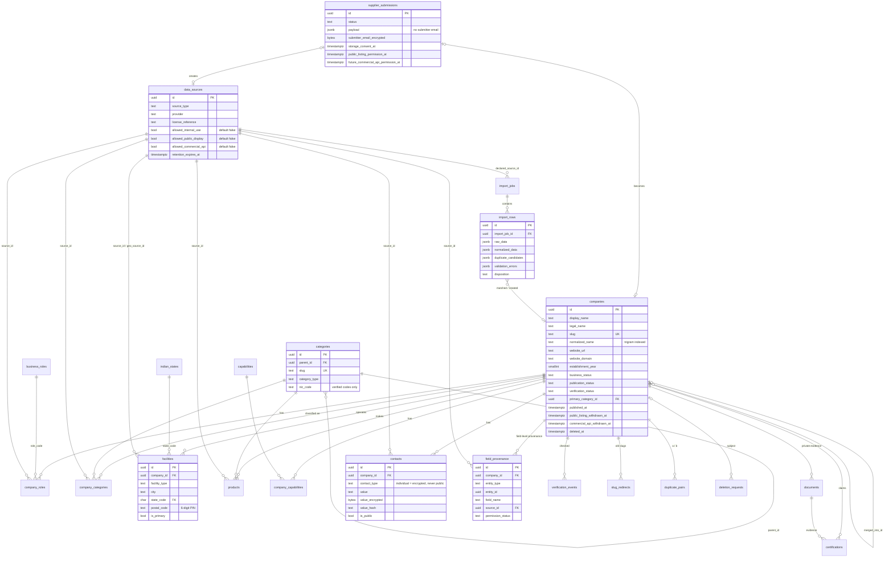
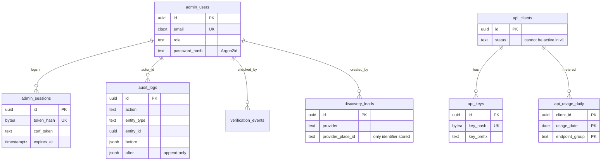

# Entity relationship diagram

Generated by hand from `db/migrations/`. Keep it in sync when the schema changes. Audit, API-future and session tables are shown in a second diagram to keep the first readable.

